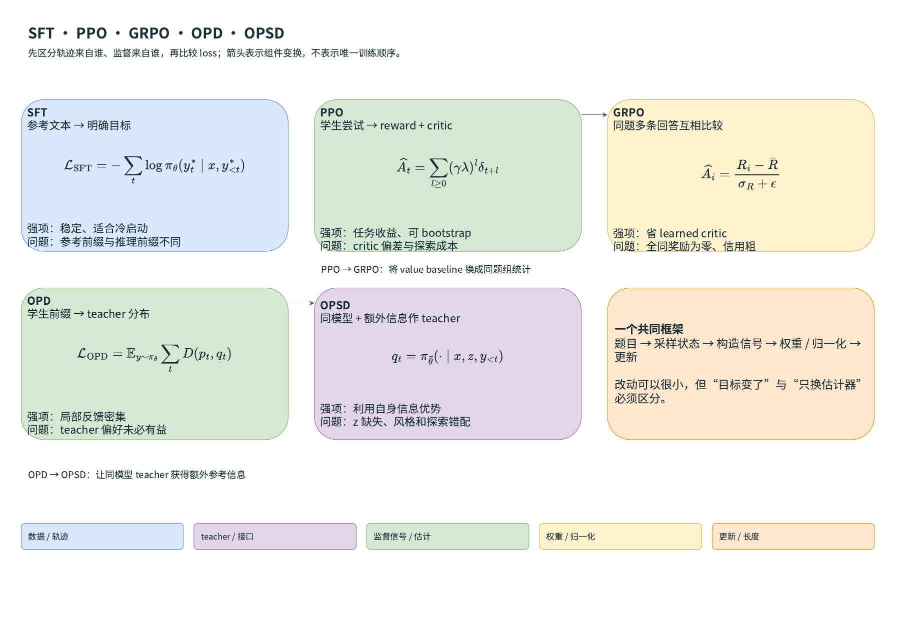
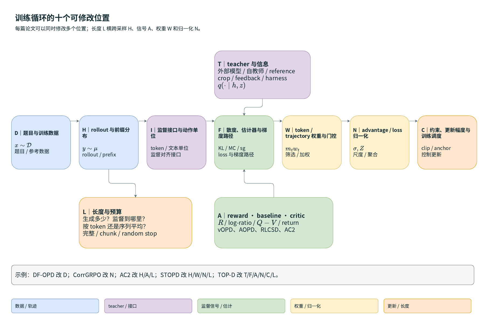
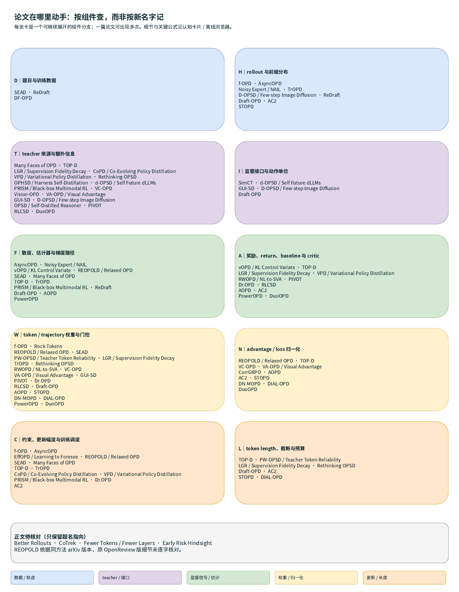
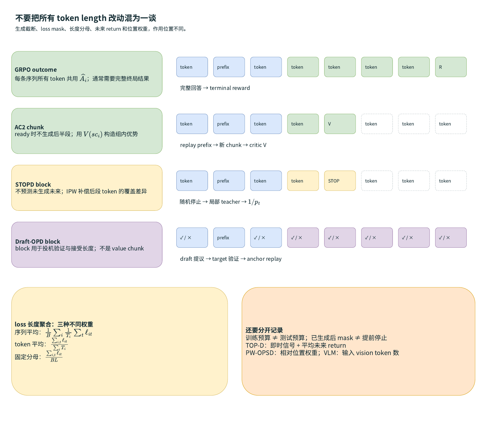
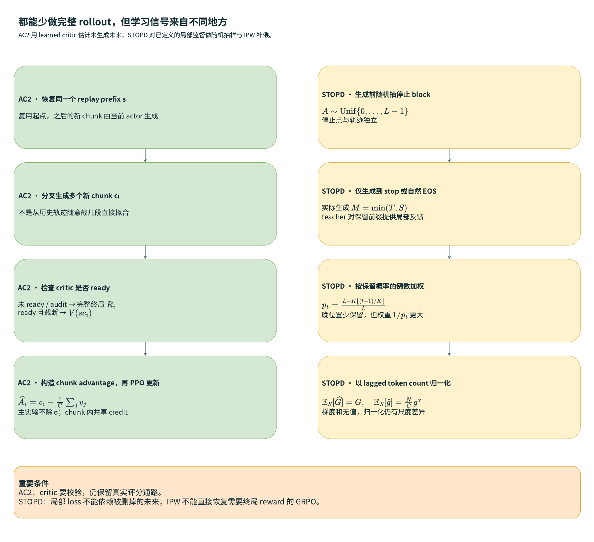
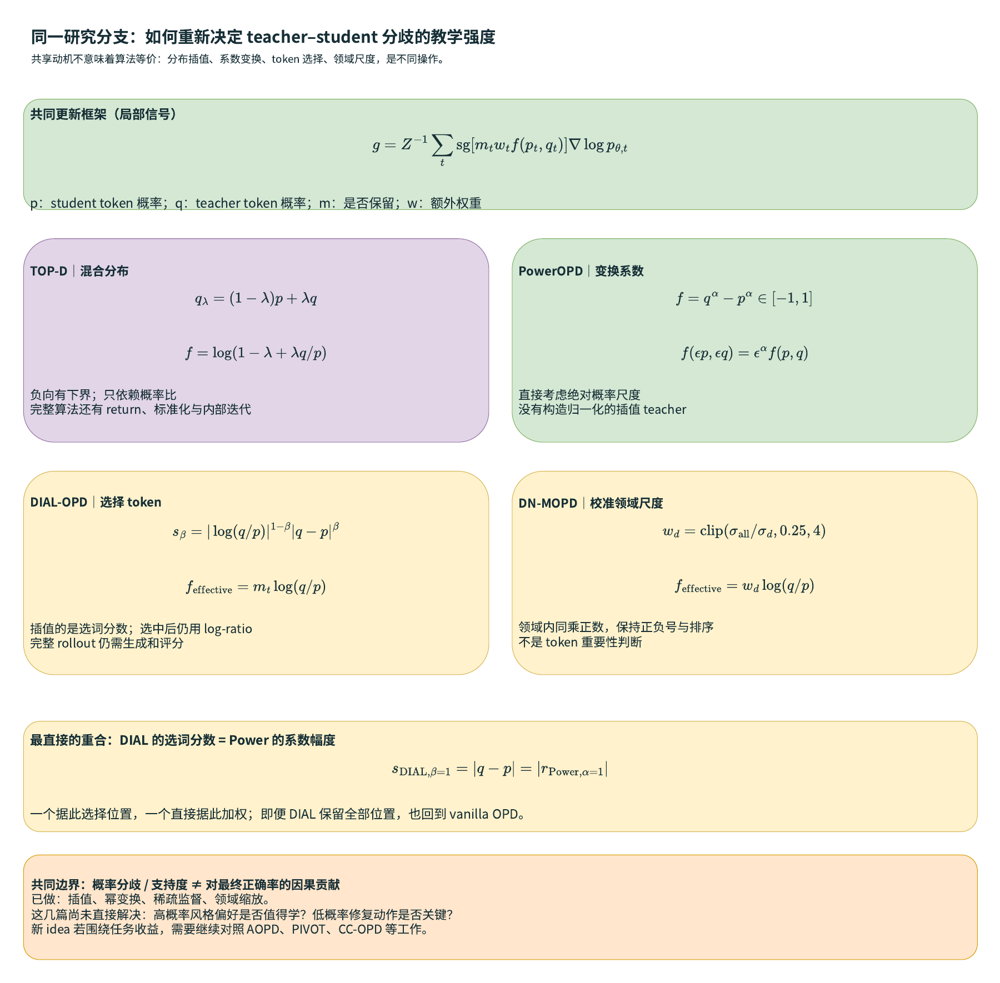

# SFT、PPO、GRPO、OPD、OPSD：按数学组件组织的 RoadMap

> 目标：先看清训练信号从哪里来、经过哪些组件，再判断每篇论文具体改了哪里。整理范围为本地 OPD 阅读集合，并加入 AC2 与 STOPD；这是一张方法结构图，不是按发布日期排列的历史继承树。

## 阅读入口

- **主图源：[roadmap.drawio](roadmap.drawio)**：18 个可编辑页面（5 页结构图＋12 页论文公式卡片＋1 页信号变换对比），可继续扩展画布、节点和论文分支。
- **[离线交互浏览器](index.html)**：按论文名、组件和证据状态筛选，每篇显示认知、方法、公式与边界。
- **[论文一句话认知与关键公式](论文一句话认知.md)**：每篇先看“认知”，再看“方法”和关键公式。
- **[论文组件矩阵](论文组件矩阵.csv)** / [结构化数据](papers.json)：方便排序、补论文与重生成图。
- **[导出图册 PDF](roadmap.pdf)**；5 张结构图预览依次见下文；全部 18 页可在交互页查看。

Markdown 与 draw.io 图中的公式均使用 LaTeX。draw.io 已启用 Mathematical Typesetting（MathJax），公式可双击编辑；论文卡片中的关键公式也是可编辑标签。精确定义以下文为准。结构示意不当作论文原文逐字公式；仅有题名的条目明确标注待核对。原目录中的 `NeurIPS2026` 标签不在本 roadmap 中自动升级为已核实录用状态。

## 1. 先记住这五句话

| 方法 | High-level 认知 | 更新依据 |
|---|---|---|
| SFT | 给模型明确的正确示范，先让它知道应该怎样回答 | 参考答案上的 next-token likelihood |
| PPO | 让模型自己尝试，用奖励与 critic 区分好坏，再控制更新幅度 | return / GAE advantage |
| GRPO | 用同一题的多个结果互相比较，省去 learned value baseline | 组内中心化、标准化奖励 |
| OPD | 模型走自己的路线，teacher 在它真正走到的前缀上给局部指导 | teacher/student 分布差或 log-ratio |
| OPSD | 同一个模型借助训练期额外信息，给普通输入下的自己提供指导 | privileged self-teacher 的分布差 |

“on-policy”主要说明轨迹/状态来自谁，不能单独决定 reward 来源、KL 方向或是否使用 critic。

## 2. 统一符号：不要混淆三种概率比和三种模型

- $x$：题目；$y=(y_1,\ldots,y_T)$：回答；$h_t=(x,y_{<t})$：student 可见的前缀。
- $\pi_\theta$：正在优化的 student / actor。
- $\mu=\pi_{\rm old}$：本轮收集 rollout 的冻结行为策略；多轮 minibatch 更新后，通常不再等于当前 $\pi_\theta$。
- $q_T$：teacher 条件分布；$z$：只在训练时供 teacher 使用的参考解法、图像区域或诊断信息。
- $\pi_{\rm ref}$：RL 的 reference anchor；它可以是初始 SFT checkpoint，角色不同于负责教学的 $q_T$。
- $R(x,y)$：外部任务终局奖励；$V_\psi(h)$：critic 对未来 return 的预测。
- $m_t$：监督 mask；$w_t$：位置、可靠性或重要性权重；$Z$：loss 聚合分母。

三种经常混淆的量：

$$
\underbrace{\rho_t=\frac{\pi_\theta(y_t|h_t)}{\mu(y_t|h_t)}}_{\text{PPO 的新旧策略比}},\qquad
\underbrace{d_t=\log\frac{q_T(y_t|h_t,z)}{\pi_\theta(y_t|h_t)}}_{\text{teacher/student 教学信号}},\qquad
\underbrace{\iota_t=\frac{q_T(y_t|h_t,z)}{\mu(y_t|h_t)}}_{\text{AOPD 的动作重要性比}}.
$$

它们的分子、分母和用途不同。STOPD 的 $1/p_t$ 又是**位置被保留概率的倒数**，并非模型 token 概率比。

## 3. SFT：参考轨迹上的交叉熵

给定数据集 $\mathcal D=\{(x,y^*)\}$：

$$
\boxed{\mathcal L_{\rm SFT}(\theta)
=-\mathbb E_{(x,y^*)\sim\mathcal D}
\left[\frac1Z\sum_{t=1}^{|y^*|}\log\pi_\theta(y_t^*|x,y_{<t}^*)\right].}
$$

这里前缀和下一 token 都来自参考文本，训练对参考前缀做 teacher forcing。$Z$ 可以按序列、token 或固定预算设置，选择不同会改变样本相对贡献。

若参考下一 token 的分布是 one-hot，交叉熵可视为从该参考分布到 student 的 FKL；若用 teacher soft distribution，得到 soft-target distillation。SFT 并不要求学生先生成一个正确 rollout。

**优点：**监督明确、稳定，能为几乎不会做的新任务建立初始支持，不必为每条训练目标在线探索。

**问题：**训练前缀来自数据，推理前缀来自自己，可能出现 exposure bias；一个参考表达会压低其他同样正确的表达；只按文本相似更新不直接保证任务正确性，也可能带来遗忘。

**论文接口：**ReDraft 主要改变参考数据 $y^*$ 的来源；STOPD 对参考 token 的随机抽样可作为作者讨论的延伸，但这不等于它已经在全部 SFT 场景验证。

## 4. PPO：奖励 → critic / GAE → 控制更新

### 4.1 从任务目标到 advantage

$$
J_R(\theta)=\mathbb E_{x,y\sim\pi_\theta}[R(x,y)].
$$

它优化任务 reward，而不是与某条文本逐 token 一致。对一般有中间奖励的任务，critic $V_\psi$ 给出 TD residual 和 GAE：

$$
\delta_t=r_t+\gamma V_\psi(h_{t+1})-V_\psi(h_t),\qquad
\widehat A_t^{\rm GAE}=\sum_{l=0}^{n-1}(\gamma\lambda)^l\delta_{t+l}.
$$

$\gamma$ 是折扣，$\lambda$ 控制多步估计；截断 rollout 的末端可用 critic bootstrap。**PPO 从数学上不要求每个 rollout 都到真实终局**；完整终局 rollout 是许多 LLM outcome-reward 配方的选择。

critic 可以用回归目标训练，例如 $\mathcal L_V=\mathbb E(V_\psi-\widehat G)^2$；也可以像 AC2 那样使用生成式离散价值监督，并非都必须是标量回归头。

### 4.2 PPO clipped surrogate

$$
\boxed{J_{\rm PPO}(\theta)=\mathbb E_{x,y\sim\mu}
\left[\frac1Z\sum_t
\min\!\left(\rho_t\widehat A_t,
\operatorname{clip}(\rho_t,1-\epsilon,1+\epsilon)\widehat A_t\right)\right].}
$$

更新时 $\widehat A_t$ 与 rollout policy $\mu$ 固定；通过 $\rho_t$ 对 $\pi_\theta$ 求导。clip 的作用是降低某些过度更新的激励，**不是保证所有概率比硬性落在该区间**，也不是精确 KL trust-region 约束。

LLM 配方可能另外减去 $\beta D_{\rm KL}(\pi_\theta\|\pi_{\rm ref})$，或把 reference KL 放进 reward，再加 entropy 项。reference KL 控制保留原策略，teacher KL 提供模仿目标，两者角色不同。详见 [PPO 原始论文](https://arxiv.org/abs/1707.06347)。

**优点：**可直接优化任务目标；critic 支持状态相关、部分 rollout 的训练；可以复用一批轨迹多次更新。

**问题：**critic 需要学习和校准，误差会影响 advantage；稀疏奖励时探索困难；多模块增加实现与算力成本；clipping 和近似估计本身并不保证逐步提高真实 reward。

## 5. GRPO：PPO 的 baseline 改成同题组统计

同一题目采样 $G$ 条回答 $y_i\sim\mu$，取得奖励 $R_i$：

$$
\bar R=\frac1G\sum_{j=1}^G R_j,\qquad
\sigma_R=\sqrt{\frac1G\sum_{j=1}^G(R_j-\bar R)^2}.
$$

典型 outcome-GRPO 对同一回答的全部 token 使用：

$$
\boxed{\widehat A_{i,t}^{\rm GRPO}=\widehat A_i
=\frac{R_i-\bar R}{\sigma_R+\epsilon}.}
$$

再将 $\widehat A_i$ 放入 PPO 式 clipped surrogate。不同实现的 std 定义、epsilon 位置、是否除 std、loss 长度聚合和 reference KL 不完全相同。上式是基线形式，不将所有现代变体都归为同一个精确算法。来源：[DeepSeekMath / GRPO](https://arxiv.org/abs/2402.03300)。

**优点：**省去 learned critic；同题比较消除部分题目难度差异；对于存在有好有坏回答的可验证任务，信号简单直接。

**问题：**同组全对或全错时，若仅用相同的二值终局奖励，$R_i-\bar R=0$；单个序列 advantage 不能指出哪个 token 真正负责；std 会影响题目与多奖励的更新尺度；一般需要多条完整回答及其终局评分。

### 5.1 CorrGRPO 的改动：就是分母

将固定奖励权重吸收进 $R_i^l$，总奖励为 $\sum_l R_i^l$。总奖励方差为各奖励协方差之和：

$$
\operatorname{Var}\left(\sum_lR^l\right)=\sum_{l,m}\operatorname{Cov}(R^l,R^m).
$$

CorrGRPO 将归一化改成：

$$
\boxed{\widehat A_i^{\rm Corr}
=\frac{\sum_l(R_i^l-\bar R^l)}
{\sqrt{\sum_{l,m}\widehat{\operatorname{Corr}}(R^l,R^m)+\epsilon}}.}
$$

零方差奖励对应相关矩阵的行列设零；数值实现还需对相关系数总和做非负保护。**分子保持原奖励尺度和权重**，因此不是各个 reward 都得到同等梯度，也不是 token credit assignment 改进。

## 6. OPD：student rollout 上的 teacher 局部监督

### 6.1 分布形式

冻结一轮 rollout 分布，记 $p_t=\pi_\theta(\cdot|h_t)$，$q_t=q_T(\cdot|h_t,z)$：

$$
\boxed{\mathcal L_{\rm OPD}(\theta)
=\mathbb E_{x\sim D,\,y\sim\mu(\cdot|x)}
\left[\frac1Z\sum_t m_t w_t D(p_t,q_t)\right].}
$$

vanilla 的 $m_t=w_t=1$。这是一张便于定位改动的局部目标模板；不是全部 OPD 论文都采用完全相同的 $D$ 或 $Z$。生成回答的是 student，teacher 不必独立生成参考回答。

三种常见 $D$：

$$
D_{\rm RKL}(p,q)=\sum_a p(a)\log\frac{p(a)}{q(a)},\qquad
D_{\rm FKL}(p,q)=\sum_a q(a)\log\frac{q(a)}{p(a)},
$$

$$
m=\tfrac12(p+q),\qquad D_{\rm JSD}(p,q)=\tfrac12D_{\rm KL}(p\|m)+\tfrac12D_{\rm KL}(q\|m).
$$

FKL 更强调覆盖 teacher 支持，RKL 更侧重 student 当前概率质量与 teacher 的兼容性；这些是一般机制描述，不是对所有任务的固定胜负判断。

### 6.2 单 token log-ratio 的梯度视角

固定状态 $h$ 和 teacher，在完整支持上：

$$
-\nabla_\theta D_{\rm RKL}(p_\theta,q)
=\mathbb E_{a\sim p_\theta}
\left[\log\frac{q(a)}{p_\theta(a)}\nabla_\theta\log p_\theta(a)\right].
$$

完整求导中的常数项利用 $\mathbb E_p\nabla\log p=0$ 消去。因此可以用 sampled token 的 detached log-ratio 乘 score gradient 来估计这个**固定状态的局部梯度**：

$$
\boxed{g_t^{\rm local}
=\operatorname{sg}\!\left(\log\frac{q_T(y_t|h_t,z)}{\pi_\theta(y_t|h_t)}\right)
\nabla_\theta\log\pi_\theta(y_t|h_t).}
$$

该等式在真正按 $p_\theta$ 采样、匹配支持及对应估计方式下成立。若使用旧策略、temperature 或 top-p/top-k 修改后的分布，必须检查提议分布和 importance correction；不能直接沿用原无偏结论。

**时间信用是另一个组件。** 若要优化整条轨迹的累积 log-ratio，轨迹分布也依赖策略，对早期动作的梯度通常涉及未来 reward-to-go：

$$
g_t^{\rm temporal}\ \sim\ \left[\sum_{u\ge t}\gamma^{u-t}d_u-b(h_t)\right]\nabla\log\pi_\theta(y_t|h_t).
$$

它和只用当前 $d_t$ 的局部梯度不是同一估计器。TOP-D 使用未来 return，vOPD 的负局部 KL baseline 则不是这个长程 task-value critic。不能仅因为都叫 advantage 就混在一起。

**优点：**监督贴近学生实际访问的前缀，token 信号密集，某些任务可以不用终局奖励。

**问题：**teacher 在错误或很长的学生前缀上未必可靠；teacher/student 差距会造成重尾 log-ratio；TopK、缓存、tokenizer 对齐可能改变估计；密集信号不等于真实任务 credit；生成和 teacher scoring 仍有成本。

基础来源：[On-Policy Distillation of Language Models](https://arxiv.org/abs/2306.13649)；具体估计器比较见本地 vOPD、AsyncOPD、Many Faces、TOP-D。

## 7. OPSD：改变 teacher 的信息条件

$$
\boxed{q_t=\pi_{\bar\theta}(\cdot|x,z,y_{<t}),\qquad
p_t=\pi_\theta(\cdot|x,y_{<t}),\qquad y\sim\mu(\cdot|x).}
$$

$\bar\theta$ 是该更新中的 teacher 参数快照，teacher 分支通常不参与本次 student 反向传播；它可以按论文配方冻结、周期同步或使用其他更新机制，不能默认全部 OPSD 都同一种同步规则。

同一个模型，看到参考解法 $z$ 后，下一 token 分布可以更好。teacher 不需要一定更大，但“看答案后的分布”与“没看答案仍能独立探索的分布”之间可能存在教学错配。

若 teacher/student 参数和所有输入条件完全一样，则纯分布匹配没有新增指导信号。AOPD 等 reward-guided 方法在 teacher 等于 student 时仍可能有 task-policy gradient，它已经不是单纯相同分布的模仿。

**优点：**不必另备更强的外部模型，能利用答案、细节图像、工具流程或诊断信息构造训练优势。

**问题：**特权信息在推理时缺失；teacher 可能改变风格、过早锁定路线或压制纠错；监督是否可迁移要具体检查。来源：[Self-Distilled Reasoner](https://arxiv.org/abs/2601.18734)，以及本地 Rethinking OPSD、RLCSD、PW-OPSD。

## 8. 统一拆成十个可修改组件

| ID | 组件 | 数学位置 | 典型论文 |
|---|---|---|---|
| D | 题目与训练数据 | $x\sim D$、参考 $y^*$ 的来源 | DF-OPD、ReDraft、SEAD |
| H | rollout / 前缀分布 | $y\sim\mu$、$h\sim d_\mu$ | f-OPD、AsyncOPD、Draft-OPD、AC2、STOPD |
| T | teacher 与额外信息 | $q_T(\cdot|h,z)$ | OPSD、Vision-OPD、OPHSD、CoPD、VPD、TOP-D |
| I | 监督接口 / 动作单位 | token、共同文本单位、chunk、去噪 step | SimCT、GUI-SD、d-OPSD、D-OPSD |
| F | loss / estimator / 梯度路径 | KL 方向、TopK、MC、stop-gradient | vOPD、AsyncOPD、Many Faces、TrOPD |
| A | reward / return / baseline / critic | $R$、$d_t$、$Q-V$、$V_\psi$ | AOPD、AC2、vOPD、RWOPD、RLCSD、LGR |
| W | mask 与权重 | $m_t w_t$ | Rock Tokens、PW-OPSD、Dr.OPD、VA-OPD、PIVOT、STOPD |
| N | 归一化 | $\sigma_R$、$Z$、组内均值与尺度 | CorrGRPO、VA-OPD、TOP-D、STOPD |
| C | 约束与更新调度 | clipping、KL anchor、teacher 同步、外推 | TOP-D、f-OPD、EffOPD、CoPD、VPD |
| L | 长度与预算 | 生成长度、监督覆盖、loss 长度分母、位置先验 | AC2、STOPD、TOP-D、PW-OPSD、Rethinking OPSD |

L 是一个横跨 H、W、N、A 的视角，因此论文会有多个标签。图上边表示组件联系，**不表示后一篇引用或继承了前一篇**。

所有条目、公式和来源见 [论文认知卡片](论文一句话认知.md)。四篇尚缺正文的原始条目没有被包装成精确算法；REOPOLD 的位置依据同方法 arXiv 版本，保留版本差异说明。

## 9. token length：至少有六处完全不同的选择

### 9.1 生成长度：生成到哪里停？

定义自然结束长度 $T$、最大预算 $L$、训练停止点 $S$，实际生成 $M=\min(T,L,S)$。预算、自然 EOS 和提前停止是不同事件。训练短前缀不等于部署也必须短回答；预算还会改变能探索到的路线与可达状态。

### 9.2 监督覆盖：已经生成的哪些位置进入 loss？

$$
\mathcal L=\frac1Z\sum_{t=1}^{M}m_t w_t\ell_t.
$$

mask 后段 loss，如果这些 token 已经生成，通常节省不了 actor decoding。真正提前停止才省生成；它也会改变监督位置的抽样分布。

### 9.3 聚合分母：平均到序列还是 token？

$$
L_{\rm seq}=\frac1B\sum_i\frac1{T_i}\sum_t\ell_{i,t},\quad
L_{\rm token}=\frac{\sum_{i,t}\ell_{i,t}}{\sum_iT_i},\quad
L_{\rm fixed}=\frac1{BL}\sum_{i,t}\ell_{i,t}.
$$

序列平均使每个回答的总权重接近相同，短回答的单 token 权重更高；token 平均使各 token 权重相同，长回答的总权重更高；固定分母避免本批长度直接改变分母，但可能改变整体尺度。这是相对权重解释，不保证某一选择一定导致长或短回答。

### 9.4 未来 return：累加还是平均后续信号？

TOP-D 使用即时奖励加未来平均：

$$
\boxed{\widetilde R_{i,t}=\widetilde r_{i,t}+
\frac1{T_i-t}\sum_{u=t+1}^{T_i}\widetilde r_{i,u}.}
$$

最后一个 token 的未来项按零处理，避免 $0/0$。它不同于简单 $\sum_{u\ge t}r_u$。之后在同 prompt 的所有 response-token return 上求 $\mu,\sigma$，并使用 token 归一化 advantage；这也不同于 GRPO 只归一化 $G$ 个终局奖励。

### 9.5 位置权重：早期与后期监督强度

PW-OPSD 按相对位置提高后段权重；LGR 针对长学生前缀监督衰减；Rethinking OPSD 在较长 thinking 预算下看到更明显退化。它们的观察对象、teacher 信息条件和诊断子集不同，不能归纳为“后段永远更可靠”或“后段永远更不可靠”。

### 9.6 input token、output token、chunk 和 denoising step

- VLM 的 vision token pruning 改输入表示长度，和截断回答不是同一操作。
- AC2 chunk 是一段新续写，用末端价值给这段共享信用。
- STOPD block 控制随机停止概率与 IPW 上界，没有自动成为一个 task-credit 单位。
- Draft-OPD block 是待 target 验证的投机提议，主要影响接受长度。
- d-OPSD 的 step 是去噪迭代；不能一律看作左到右 token。

## 10. AC2：信任经过校验的 critic，少生成后半段

从 replay 中恢复同一个 prefix $s$，当前 actor 分叉生成 $G$ 个新 chunk $c_i$：

$$
\boxed{v_i=\begin{cases}
R_i,&\text{完整 continuation、未 ready 或 audit},\\
V_\psi(s\cdot c_i),&\text{ready 且在 chunk 末端提前停止},
\end{cases}\qquad \widehat A_i=v_i-\frac1G\sum_jv_j.}
$$

AC2 主实验不除组 std。replay prefix 只作条件，actor loss 只更新新 chunk token。chunk 内 token 共用 $\widehat A_i$，所以它改善信用粒度，但不直接给每个 token 精确因果分数。

critic 与 actor 共享参数，通过不同 prompt 输出离散价值；利用真实完整结果、reference 和 readiness 门槛建立可用性，仍保留 refill、unready 及 audit 的完整 rollout。它属于 actor-critic RL，与 teacher KL OPD 不同。

**值得记住：**critic 既可以作 baseline，也可以作未生成未来的 bootstrap；只有后者真正省掉当前后半段生成。

## 11. STOPD：无需估计未来，随机截断并纠正位置抽样

使用 1-based token 索引，最大长度 $L$、block 宽度 $K$，训练前独立抽停止 anchor：

$$
A_i\sim\operatorname{Uniform}\{0,\ldots,L-1\},\quad
S_i=\min\left\{K\left(\left\lfloor\frac{A_i}{K}\right\rfloor+1\right),L\right\},\quad
M_i=\min(T_i,S_i).
$$

位置 $t$ 的保留概率为：

$$
\boxed{p_t=P(S_i\ge t)=\frac{L-K\lfloor(t-1)/K\rfloor}{L},\qquad w_t=\frac1{p_t}.}
$$

若 $K$ 整除 $L$，最大权重为 $L/K$。例如 $L=8,K=2$：四个 block 的保留概率为 $1,3/4,1/2,1/4$，权重为 $1,4/3,2,4$。晚位置少生成，但生成到时权重更大。

固定完整轨迹与局部 teacher feedback，令 $h_{i,t}$ 是该位置的局部梯度、$I_{i,t}$ 为保留指示：

$$
\boxed{\widehat G=\sum_{i,t}\frac{I_{i,t}}{p_t}h_{i,t},\qquad
\mathbb E_S[\widehat G]=\sum_{i,t}h_{i,t}=G.}
$$

成立要求停止点独立、局部 loss 不依赖被删除的未来、相同前缀的生成分布不因剩余预算改变。固定截断使后段 $p_t=0$，不能这样补偿；随意用相同权重随机截断也会偏向前段。

归一化采用当前停止前已固定的 lagged count $C_k$：

$$
\widehat g_k=\frac{\widehat G_k}{C_k},\qquad
\mathbb E_S[\widehat g_k]=\frac{N_k}{C_k}g_k^{\rm Vanilla}.
$$

因此原文保持的是**梯度和的期望**；归一化梯度仍有 $N_k/C_k$ 尺度差异。用同批随机 $\widehat N_k$ 作分母也不能利用“分子分母分别无偏”推出比值无偏。STOPD 对这两类误差给出分析，不保证 Adam/Muon 与完整训练路径逐步相同。

**AC2 与 STOPD 的关键差异：**AC2 用 learned value 补充未生成未来的任务信号；STOPD 对已有局部蒸馏信号的随机缺失做统计补偿。两者都减少完整 rollout，但并不互相等价。

## 12. 把最近几篇串成一条问题链

1. **SFT / ReDraft：**不会做时，怎样构造明确而接近学生能力的参考文本？
2. **OPD：**训练前缀来自学生时，teacher 应怎样给局部监督？
3. **OPSD / Vision-OPD / OPHSD：**同模型能否借助额外信息获得教学优势？
4. **Rethinking / Many Faces：**额外信息带来的偏好，是否能迁移到没看这些信息的 student？
5. **PW-OPSD / Rock Tokens / TrOPD：**哪些位置值得监督，哪些应降权或跳过？
6. **RLCSD / AOPD / Dr.OPD：**怎样让监督更贴近内容正确性或 student 的任务收益？
7. **vOPD / TOP-D / CorrGRPO：**信号有用之后，怎样控制方差、极端值与更新尺度？
8. **f-OPD / AsyncOPD：**异步与缓存怎样改变原信号的有效性？
9. **AC2 / STOPD / Draft-OPD：**怎样少生成、少打分或更有效复用状态，同时保留需要的学习信号？
10. **DF-OPD / CoPD / VPD / SimCT：**题目、teacher 演化和监督接口怎样进一步扩展？

这是解释上的组织顺序，不是“一个方法一定优于前一个方法”的排行榜。

## 13. 如何判断一个小改动是否重要、是否真的能 work

一个式子改动很小，仍可能改变训练机制，例如 CorrGRPO 的分母影响尺度，STOPD 的 $1/p_t$ 决定是否补回后段监督。反之，结构复杂也不自动表示收益更大。每篇用同一套问题读：

- **哪一组件变了？**写出原式和新式，避免只记新方法名。
- **目标还是估计器变了？**vOPD baseline 的目标期望与 STOPD 的梯度和补偿，不同于 AOPD 改 teacher 监督目标。
- **新信号是否有额外信息？**参考、verifier、critic、反事实分支和外部图像区域分别要计成本。
- **是否处理了真正失败条件？**全错组、低支持、长前缀、错误参考和数据陈旧都不能只看平均正确率。
- **收益的计量口径是什么？**完整时间、actor decoding FLOPs、生成 token、teacher forward 和额外 scoring 应分开。
- **理论在哪些条件下成立？**“局部无偏”“精确 proximal 改进”“经验代理有效”是三种不同证据。

### 可以延伸的研究路径（未验证假设）

| 思路 | 可组合组件 | 必须解决的问题 |
|---|---|---|
| 截断 + 方差控制 | STOPD H/W/N + vOPD A | IPW 使后段权重变大，baseline 能否缓解？局部性与归一化条件是否保留？ |
| critic 引导更有用的 OPD | AC2 A + AOPD / Dr.OPD | critic 应预测 student 的后续收益；怎样避免 critic 偏差和自我校准循环？ |
| 长度感知的可靠监督 | LGR / PW-OPSD W/L + STOPD H | 自适应停止会改变 inclusion probability，不能沿用独立均匀停止的 IPW。 |
| 自生成题目 + 信号筛选 | DF-OPD D + reward-aware W | 小题库是否覆盖关键错误分支？是否有可靠 verifier 与有区分度的结果？ |
| 多奖励 + 蒸馏联合训练 | CorrGRPO N + OPD 分支 | 只改 RL 分支分母；与 teacher KL 的相对尺度需重新测量。 |

## 14. 文件更新方式与证据范围

`papers.json` 是论文条目数据源；[build_roadmap.py](build_roadmap.py) 根据它重生成交互页、矩阵、卡片和 draw.io 源图。也可直接在 draw.io 中修改图，注意脚本再次生成会覆盖自动布局图源，因此手工版本请另存。 [export_roadmap.py](export_roadmap.py) 使用本机 draw.io 与 Poppler 重导出全部 PNG/PDF；逐页渲染以避开多页 MathJax 导出的裁切问题。PDF 为阅读版，编辑使用 `.drawio`。

41 篇条目包含原列表 29 篇、TrOPD、OPSD、ReDraft、PIVOT、Dr.OPD、CorrGRPO、RLCSD、Draft-OPD、DF-OPD、AOPD、AC2、STOPD。待正文核对的四篇：Better Rollouts、CoTrek、Fewer Tokens/Fewer Layers、Early Risk Hindsight。REOPOLD 使用同方法的相关 arXiv 版，不声称已核对原 OpenReview 版细节。

已读论文依据本地 PDF 与阅读笔记；方法入口和基础来源保存在条目中。这里没有重做所有实验，也没有依据文件夹名统一宣称会议录用。

### 在 draw.io 中编辑公式

各页已启用数学排版。双击公式标签即可编辑 LaTeX；独立公式用 `$$...$$`，行内公式用 `$...$`。如果要查看源代码，可在 Extras → Mathematical Typesetting 中切换数学排版；操作参见 [draw.io 官方数学排版说明](https://www.drawio.com/docs/manual/text/math-typesetting/)。

## 新增：TOP-D、PowerOPD、DIAL-OPD 与 DN-MOPD 的共同分支

本次增加 DN-MOPD、DIAL-OPD、PowerOPD，catalog 共 **44 篇**。DIAL-OPD 按用户提供信息标为 ICLR 2027，不推定录用。

- [完整信号变换对比与数学推导](OPD信号变换对比.md)：区分分布插值、系数幂变换、选词分数插值和领域归一化。
- DIAL 的 $\beta=1$ 选择分数正好等于 Power 的 $\alpha=1$ 系数幅度，但两者最终更新不同。
- DN-MOPD 主要校准各领域教学强度，概率尺度也不等于 token 对任务的因果价值。
- 新论文公式在第 16 页；共同认知、精确联系及研究边界在第 18 页。

## 2026-10-15：迁移与分类更新

当前目录共45条论文记录；分类入口见[论文总目录](../README.md)。本次补入DuoOPD认知与公式，将顶层15篇并入四个研究问题类别，并补齐REOPOLD同方法arXiv版本和VC-OPD的PDF及方法。历史小节中的41/44篇是当时的快照，不代表当前总数。尚缺原文的四条明确保留待补状态。
